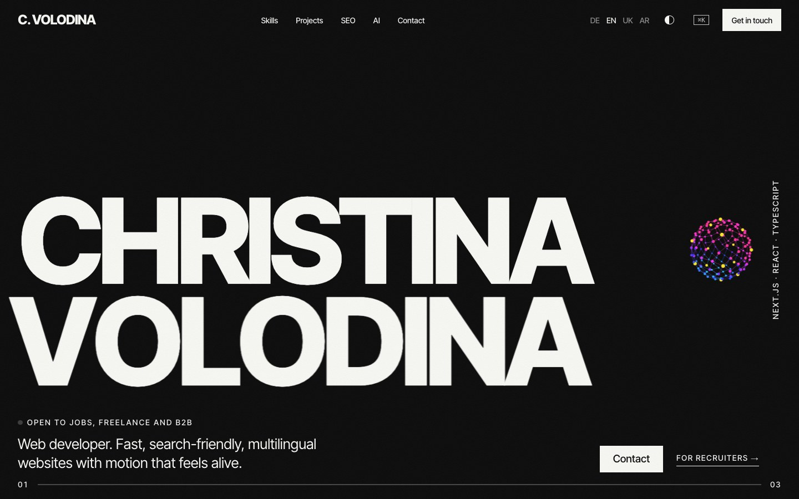

# Christina Volodina, developer portfolio



A portfolio built to be checked, not just admired: motion and WebGL on top, and under it real SEO, accessibility, tests and CI that you can open and verify.

**Live site:** not published yet (domain pending). Run it locally, see below.

## What is inside

- **Four languages**: German, English, Ukrainian and Arabic with full right-to-left layout (`next-intl`, locale routing, hreflang).
- **Motion and WebGL**: pinned horizontal hero, CSS 3D tunnel, 3D project carousel, water-refraction titles and images, a ray-marched 3D orb, a scroll-velocity marquee. All of it respects `prefers-reduced-motion`.
- **SEO you can inspect**: the SEO section reads this page's own `<head>` live (title, canonical, hreflang, JSON-LD) and shows Web Vitals measured in your browser.
- **For recruiters**: a one-page summary (`/hire`), all projects with live links (`/work`), a plain-text CV for applicant tracking systems (`/cv`), and personal links such as `/en?for=Company`.
- **Engineering notes**: a design system page that reads its tokens from CSS (`/design`), a CSS playground in an isolated shadow root (`/lab`), and short notes (`/notes`).
- **Small things**: command palette (`Ctrl/⌘ + K`), light and dark theme, a developer view with grid and live stats, custom 3D 404 page.

## Quality

| Check | Result |
|---|---|
| Lighthouse (desktop, production build) | Performance 94, Accessibility 100, Best practices 100, SEO 100 |
| End-to-end tests (Playwright) | 28 passing: languages and RTL, SEO head, layout overflow at 320 to 1024 px, palette, theme, forms, 404 |
| Pull request checks (GitHub Actions) | ESLint, TypeScript, production build, e2e |

The Lighthouse numbers are stored with their date in `src/config/lighthouse.ts` and re-measured after big changes.

## Stack

Next.js 16 (App Router, Server Components first), React 19, strict TypeScript, CSS Modules, GSAP with ScrollTrigger, Lenis, raw WebGL, next-intl, Playwright.

## Run it

```bash
npm install
npm run dev          # http://localhost:3000, redirects to /de
npm run build && npm start
npm run test:e2e     # run `npm run build` first; uses Chrome locally
```

Node 20 or newer.

### Environment variables (optional)

| Variable | Purpose |
|---|---|
| `NEXT_PUBLIC_SITE_URL` | Public address of the site. Used for canonical URLs, sitemap and Open Graph. Defaults to `http://localhost:3000`. |
| `NEXT_PUBLIC_WHATSAPP` | WhatsApp number (digits only) for the contact form. Defaults to the number from my studio site. |

## Project map

```
src/app/[locale]/        pages: home, hire, work, notes, design, lab, cv, case studies, legal, 404
src/components/          sections, motion (water, orb, companion), command palette, dev view
src/config/              site data, projects, icons, Lighthouse and test results (generated)
messages/                de, en, uk, ar translations
e2e/                     Playwright tests
scripts/                 PDF profile card, test and contribution recorders
```

## How I work on it

Every project of mine has a `CLAUDE.md` with the stack, design rules, a security checklist and things that never happen (no push without approval, no invented data, no secrets in the frontend). Claude Code writes much of the code, and each step ends with build, lint and a real browser check. More in the notes on the site (`/notes/ai`).

## Related repositories

- [noform](https://github.com/Kristin198689/noform), [beauty-studio-demo](https://github.com/Kristin198689/beauty-studio-demo), [pizza-doner-lieferservice](https://github.com/Kristin198689/pizza-doner-lieferservice), [apartament-demo](https://github.com/Kristin198689/apartament-demo)

## Status

All content is mine. Names, logos and trademarks of tools shown on the site belong to their owners.
